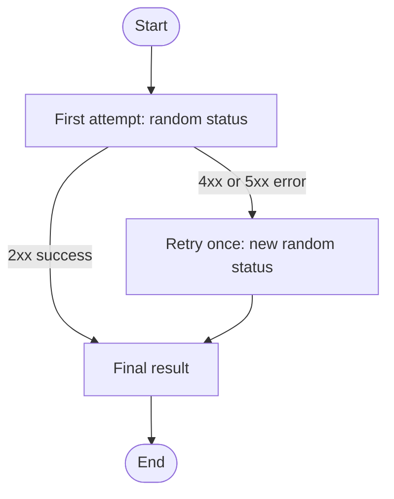

# Message retry simulation

One endpoint, three LangGraph steps, at most two sending attempts. This
implementation and its tests were prepared with Codex assistance; this branch is
no longer a blank scaffold. Follow Odin's disclosure and recording requirements
and confirm prepared-code eligibility before presenting it as task work.

## Flow



`POST /send` accepts a nonblank `recipient` and `message`. Each sending attempt
randomly chooses `200`, `201`, `400`, `429`, `500` or `503`. A 2xx ends successfully;
any simulated error on the first attempt gets one retry. The retry always goes
to the final result, whether it succeeds or fails. There is no third attempt.

The response contains `status`, `status_code`, `attempts`, `history` and
`simulation: true`. The actual HTTP response code matches the last simulated
status code. `history: [503, 200]` means the retry succeeded; `[500, 503]` means
both attempts failed. Each request starts with fresh history.

No real message is sent, no external service is contacted and no LLM is called.
Here `sent` means simulated 2xx success, not confirmed delivery. Retrying every
simulated 4xx/5xx is an exercise rule, not a production delivery policy. Invalid
request data is rejected with HTTP 422 before the workflow starts.

## Files

- `app.py`: request model, sender, route, final result, graph and endpoint.
- `test_app.py`: controlled tests for success, retry, failure and input validation.
- `requirements.txt`: pinned dependencies.
- `examples/testing-commands.txt`: copyable Mac and Windows Terminal commands.

## Run on Mac

Use Python 3.12. From this repository's root:

```bash
python3.12 -m venv .venv
source .venv/bin/activate
python -m pip install -r requirements.txt
python -m uvicorn app:app --host 127.0.0.1 --port 8000
```

Open `http://127.0.0.1:8000/docs`, or use the commands in
`examples/testing-commands.txt`. Manual requests are random; repeated requests
can produce different results. To check every branch reliably, tests replace
the random selector with known status sequences. They still run the actual
endpoint and graph and check HTTP status, body, history and attempt count.

```bash
python -m pytest -v
```

Output appears in Terminal. The app and copyable commands do not automatically
save result files. Save actual results and your diagram as Studio requires;
exclude `.venv/` and caches from the submission.
